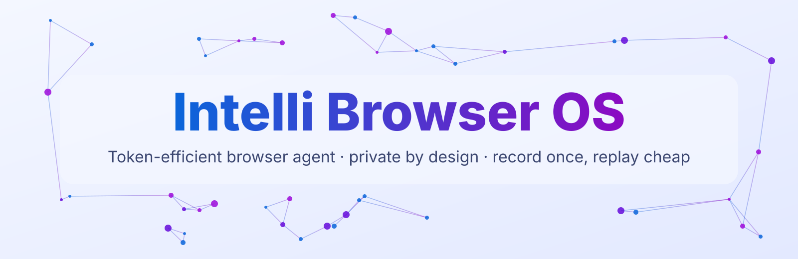

<picture>
  <source media="(prefers-color-scheme: dark)" srcset="static/intelli-browser-os-dark.svg">
  
</picture>

# Intelli Browser OS

A browser agent that completes web tasks from plain English while spending as few LLM tokens as it can, keeping
your confidential data off the cloud model, and turning any successful run into a skill you can replay later.

Built on the open-source [browser-use](https://github.com/browser-use/browser-use) library (MIT). See
[Credits](#credits-and-license) and the original README in [`docs/`](docs/upstream-browser-use-README.md).

```bash
intelli run "open news.ycombinator.com and tell me the top story" --save-skill hn-top
intelli skills run hn-top            # replay without the LLM-driven loop
```
(`intelli` and `bu-agent` are the same command.)

---

## Why this exists

Browser agents are expensive in three ways: tokens (every step re-sends a large page and often a screenshot), trust
(passwords and personal data pass through a cloud model), and repetition (the same task is re-planned from scratch
every time). Intelli Browser OS attacks each one directly.

| Problem | What it does | Where |
|---|---|---|
| **Screenshot tokens** | Fits each screenshot into a per-provider size box, keeps the smaller of JPEG/PNG, memoizes by content, can skip frames identical to the last one, and can drop screenshots entirely (`--vision off`) or send them only on request (`--vision auto`). | `browser_use/screenshots/optimizer.py` |
| **Wrong cost estimates** | `intelli calibrate --model X` measures what a model *actually* charges for an image (3 tiny API calls) and stores the fit, instead of trusting a published formula that may be stale for newer models. | `browser_use/screenshots/calibration.py` |
| **Repeated prompt cost** | The per-step prompt is ordered stable → volatile with an Anthropic cache breakpoint after the append-only history, so each step re-reads the previous step's prefix from cache rather than paying for it again. | `browser_use/agent/prompts.py` |
| **Confidential data** | An encrypted local vault (SQLite + Fernet). The cloud LLM only sees `<secret>password</secret>`; the real value is substituted locally, only on matching domains. | `browser_use/vault.py` |
| **Cloud exposure of private pages** | A privacy router sends a step to a **local** model (e.g. Ollama) when the page matches a vault domain or contains an email, valid card number or SSN-shaped number; everything else goes to the cloud model. It fails closed. | `browser_use/llm/router.py` |
| **Repeating work** | Save a successful run as a skill (`--save-skill`), find it by intent, and replay it with new parameter values. Replay re-resolves elements on the live page and only calls an LLM for fallback steps and the summary. Secrets are redacted in the saved files. | `browser_use/skills/local.py` |

## Quick start

Requires Python 3.11+ and [uv](https://docs.astral.sh/uv/).

```bash
git clone https://github.com/rahulparimal/browser-use-add && cd browser-use-add
uv tool install -e . --python 3.12
uvx playwright install chromium          # once, unless Chrome is already installed
export OPENAI_API_KEY=...                # or ANTHROPIC_API_KEY / GOOGLE_API_KEY

intelli run "open news.ycombinator.com and tell me the top story" --model openai:gpt-4o
```

The provider is auto-detected from whichever key is set; override with `--model provider:model`
(`openai`, `anthropic`, `google`, `ollama`). Output ends with a line like
`tokens: prompt=… (cached=…) completion=… cost=$…` (the dollar figure is an estimate; check your provider's usage page).

## Command reference

```text
intelli run "<task>" [--model provider:model] [--headless] [--max-steps N]
            [--vision on|off|auto] [--no-optimize-images] [--skip-unchanged]
            [--save-skill NAME] [--use-vault] [--local-model ollama:MODEL] [--local-fallback-cloud]

intelli skills   list | find "<query>" | show NAME | delete NAME | run NAME [--set KEY=VALUE ...]
intelli vault    set DOMAIN NAME | list | delete DOMAIN NAME
intelli calibrate --model provider:model
```

### Choosing a vision mode
- `on` (default): a screenshot every step. Best for layout-dependent pages (forms, charts, captchas).
- `off`: page text only. Cheapest; fine for read-only text sites.
- `auto`: a screenshot only when the agent asks for one. A middle path for mostly-text sites.

### Using confidential data
```bash
intelli vault set example.com password          # prompts; the value is never taken from argv
intelli run "log in to example.com and download the latest invoice" --use-vault --local-model ollama:llama3.1
```
The model sees `<secret>password</secret>`. The value is decrypted and typed locally, only on `example.com`.

### Record once, replay
```bash
intelli run "download last month's invoices as PDF" --save-skill invoices
intelli skills find "invoices"
intelli skills run invoices --set month=2026-10
```
Skills live under your config directory (`~/.config/browseruse/local_skills/<name>/`: `history.json`, `skill.json`,
and a readable `SKILL.md`).

### Python API
```python
from browser_use import Agent, Browser
from browser_use.llm.openai.chat import ChatOpenAI

agent = Agent(
    task="Find the cheapest laptop on example.com",
    llm=ChatOpenAI(model="gpt-4o"),
    browser=Browser(headless=True),
    image_optimizer=True,        # token-aware screenshots
    use_vision="auto",
    record_skill="laptop-price", # saved when the run succeeds
)
history = await agent.run()
```

## What we measured (and what we haven't)

Honest numbers from real runs on `gpt-6-luna` and `gpt-4o` against news.ycombinator.com:

- A one-step read-only task used **15.5k prompt tokens with `--vision off` vs 23.7k with a screenshot**: roughly a
  third less, same answer. One run each, so treat the percentage as indicative.
- Across a multi-step task, the optimizer-on run used about 20% fewer prompt tokens per step than optimizer-off, but the
  two runs took different paths, so this is **not** a controlled result.
- Screenshots appear to cost far more than the published OpenAI formula predicts on newer models (a rough, confounded
  estimate of ~8k tokens at 1024×768). Run `intelli calibrate` for your model to get a measured figure.

Not yet measured: end-to-end savings over many tasks, task-success impact of `--vision auto`, accuracy of the privacy
router's detection, and Anthropic prompt-cache hit rates. We'd welcome benchmarks.

## Privacy model and limits

- **Vault** protects values *at rest* (encrypted SQLite, owner-only file permissions). It does not defend against
  malware running as your user, which can read the key file. Set `BU_VAULT_KEY` to supply your own key.
- **Substitution** happens locally and only on domains you registered, but a page can still *display* private data.
- **Routing** is heuristic. It catches vault domains and common PII patterns. Names, addresses, balances and similar
  on a non-vault domain are **not** detected and will reach the cloud model.
- **Local models** are usually weaker at the structured output the agent needs, so expect more failed steps.
- If the local model errors on a sensitive step the router **refuses to send it to the cloud** unless you opt in with
  `--local-fallback-cloud`.
- Token cost for routed runs is attributed to the cloud model's pricing, so the printed estimate can be off.

## Project status

Working end to end on macOS with OpenAI models (single- and multi-step tasks, skill recording). Unit tests cover the
optimizer, calibration, vault, router, skills store and CLI (`tests/ci/`). The browser-driven CI tests need Chrome and
network access and have not been run as a full suite in the environment where this was developed; run
`uv run pytest -q tests/ci` on your machine before relying on it.

## Layout

```text
browser_use/agent_cli.py                  CLI (intelli / bu-agent)
browser_use/screenshots/optimizer.py      resize, encode, dedupe, token estimates
browser_use/screenshots/calibration.py    measured per-model image cost
browser_use/vault.py                      encrypted SQLite vault
browser_use/llm/router.py                 local/cloud privacy router
browser_use/skills/local.py               record / find / replay skills
```

## Credits and license

Intelli Browser OS is a derivative of [browser-use](https://github.com/browser-use/browser-use) by Gregor Zunic and
contributors, released under the MIT License (see [LICENSE](LICENSE)). The browser control, DOM processing, agent loop
and LLM integrations come from that project; the token-efficiency, vault, router, calibration and skills features are
additions in this fork. "Browser Use" is the upstream project's name; this fork is independent and not affiliated with
or endorsed by it.
